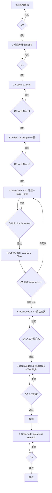

# 移动端全栈开发工作流

> 版本: v0.5
> 更新: 2026-10-19
> 修订: 支持以已有 PRD 为起点（跳过阶段 1-2 的生成，进入 L1 intake）；保留 Codex/OpenCode 路由、自动降级、icon/splash、阶段 8 archive。

从「已上架 App 功能分析或已有 PRD」到「TestFlight / 内测提测 + 归档」的端到端工作流。每个阶段都有明确输入、产出、门禁和回退路径，AI Agent 可以断点续跑，人只在关键节点签核。

## 1. 目标与适用范围

适用场景：

- 基于已有上架 App 做功能拆解，重构或开发同类产品
- 从功能知识库出发，完成主题、竞品、PRD、UI、开发、测试、商店文案、提测
- 技术栈为 RN、Flutter、Kotlin、Java，交付 iOS / Android 移动应用

不适用场景：

- 纯后端服务、Web 站点、桌面端
- 需要破解、绕过登录/付费/DRM、抓取非公开数据的场景
- 没有人工签核、要求 AI 直接上线到生产环境的场景

核心原则：

1. **工件驱动**：每个阶段的结论必须落盘到 `artifacts/`，口头结论视为未完成。
2. **门禁制**：G1-G7 逐级通过，不允许跳阶段。门禁失败必须回到本阶段修复。
3. **证据优先**：竞品、用户、技术结论标注来源与日期；假设必须显式写「假设」。
4. **人工签核**：G2（主题 + PRD）、G3（5 图）、G7（提测）必须由人确认。
5. **合规与原创**：只分析公开可观察的行为；不复制竞品代码、图片、文案、品牌资产。
6. **密钥安全**：签名、API Key、测试账号只放环境变量或 Keychain，绝不入库。
7. **可回退**：每阶段保留版本；发布保留上一个可用包与远程开关。
8. **目标一致性**：主题必须基于用户提供的目标 App 做二创/优化，保持同品类与核心闭环；偏离品类的方案直接淘汰。
9. **5 图定 P0**：P0 范围以 5 图最终展示内容为准；5 图之外默认 P1/P2，不进入首版。
10. **Mock 优先**：MVP 数据全部使用本地 mock；通过 Repository 接口隔离，后续可替换真实数据源，但不得让真实 API 成为 P0 阻塞。
11. **单端足够**：提供一个平台的商店链接或安装包即可启动；另一平台可选后补，不阻塞分析、设计与开发。
12. **凭证后置**：开发者账号、签名、TestFlight 权限在阶段 7 才收集；前期不因缺少凭证而阻塞。
13. **排期自适应**：根据范围、估算与并行度自动修正截止日期；不可行时给出缩范围或延期方案，不硬卡。
14. **逆向可选**：需要更深的功能/实现逆向时，若环境提供 `rea` skill 且用户授权，可加载使用；不可用时回退公开行为分析，不伪造结果。
15. **Spec 驱动**：阶段 2/3 由 Codex 写入 spec-manager 的 L1/L2；阶段 4/5 由 OpenCode 基于冻结的 L3 创建 Task 并实现；禁止绕过 spec-manager 直接写代码。
16. **Agent 分工**：Codex 负责产品/设计规格，OpenCode 负责实现/测试/发布；两者通过 spec-manager 的本地 specs、decisions、tasks 协作，不靠聊天记忆。

## 2. 角色

| 角色 | 职责 | 由谁承担 |
| --- | --- | --- |
| 产品负责人 | 确认主题、范围、PRD、5 图、提测结论 | 人 |
| 编排 Agent | 驱动阶段、维护状态、检查门禁、自动排期与 Agent 路由 | OpenCode `mobile-workflow` |
| 分析 Agent | 功能拆解、知识库、Codex handoff packet | OpenCode `mobile-feature-analysis` |
| 产品/设计 Agent | L1 PRD、竞品、L2 设计系统、5 图 | **Codex** `mobile-prd-authoring` / `mobile-ui-prototype` |
| 实现 Agent | L3.1 实现、框架、P0 填充、自测 | **OpenCode** `mobile-app-implementation` |
| 测试 Agent | L3.2 自动化主流程、缺陷分级、回归 | **OpenCode** `mobile-e2e-testing` |
| 发布 Agent | L3.3 商店文案、L3.4 打包/真机/提测、L3.5 归档 | **OpenCode** `app-store-listing` / `mobile-testflight-release` / `mobile-release-archive` |
| 共享状态 | specs、decisions、tasks、verification evidence | **spec-manager** |

一个人可以承担多个角色，但门禁签核不能由执行同一动作的 Agent 自己伪造。Codex 不能给自己写 L1/L2 签核，OpenCode 不能在 L3 冻结前写代码。

## 2.5 Agent 路由与 spec-manager 协作

### 分工

| 阶段 | 执行 Agent | 原因 |
| --- | --- | --- |
| 0 建档/排期 | OpenCode | 编排、环境与工件 |
| 1 功能分析 | OpenCode | 代码/文件/运行时上下文 |
| 2 创意主题 + 竞品 + PRD | **Codex** | 产品推理、写作、竞品研究 |
| 3 设计系统 + 5 图 + P0 锁定 | **Codex** | 视觉/设计规格与 Stitch/生成 |
| 4 框架 + P0 实现 | **OpenCode** | 代码、文件编辑、构建 |
| 5 自动化测试 | **OpenCode** | 测试脚本、运行、修复 |
| 6 商店文案 | OpenCode（Codex 可选） | 需要引用实现证据；Codex 可代写 |
| 7 打包/TestFlight/真机 | **OpenCode** | 构建、上传、设备验证 |

### Codex 可用性检测与自动降级

阶段 0 执行：

```bash
command -v codex >/dev/null 2>&1 && codex --version
```

- **可用**：`agent_routing.stage_2_3 = codex`，阶段 1 后生成 handoff 并暂停。
- **未安装/不可用**：`agent_routing.stage_2_3 = opencode`，`codex_fallback = true`；跳过 handoff，由 OpenCode 按同一 L1/L2 模板执行阶段 2/3。
- 降级不改变门禁：仍必须 L1/L2 人工确认、L3 冻结后才能写代码。
- 不因 Codex 缺失而阻塞流程，也不伪造 Codex 产物。

### spec-manager 规格链

```text
L1 PRD（Codex）
  └── L2 Design + 5图 + P0 锁定（Codex）
        ├── L3.1 Implementation（OpenCode）
        ├── L3.2 Automated E2E（OpenCode）
        ├── L3.3 Store Copy（OpenCode，Codex 可选）
        ├── L3.4 Release & TestFlight（OpenCode）
        └── L3.5 Archive & Handoff（OpenCode）
              └── Agent Tasks（T-xxx）
```

规则：

- L2 的 `--parent` 必须是 L1；L3 的 `--parent` 必须是 L2。
- L1/L2 由人确认后 `draft → confirmed`；L3 由人确认后 `draft → frozen`。
- 只有 L3 `frozen` 才能创建 Agent Task 和写实现代码。
- L3.2 依赖 L3.1；L3.3 依赖 L3.2；L3.4 依赖 L3.3；L3.5 依赖 L3.4。
- 每次 Task 必须记录 steps 与 verification evidence，不能口头完成。
- 规格变更走 `spec-manager change`，不要直接改已冻结 L3 的实现范围。
- `--prd` 起点：阶段 1 可 skipped；阶段 2 进入 L1 intake，保留 source/hash/gap，不能重新生成 PRD 或改写范围。
- `--prd-spec` 已 confirmed：直接进阶段 3；draft 则先做 L1 review。

### PRD 起点

- `--prd <path|url>`：阶段 1 可 skipped；阶段 2 进入 L1 intake；原始 PRD 保存到 `artifacts/02-prd/source-prd.md`，记录 SHA256 与 `prd-intake.md`。
- `--prd-spec <L1-code>`：已 confirmed 直接进阶段 3；draft 先 review。
- intake 模式不重新生成主题/竞品/PRD，也不改写用户范围；缺章节只提问/标 gap。
- `--prd` 只从阶段 2 开始；要从阶段 3 开始请先导入 L1 并用 `--prd-spec`。

### 初始化

```bash
cd <project>
spec-manager project init --name <project>
spec-manager project agents --provider all
# 或分别安装：
spec-manager codex install
spec-manager opencode install
spec-manager project doctor
```

多仓库时先把 specs 放到共享 planning repo，再在代码仓库配置 `specStore.path`，具体见 spec-manager README。

### 核心命令

```bash
spec-manager next "<request>" --topic <topic>
spec-manager brief "<request>" --topic <topic>
spec-manager spec list --topic <topic>
spec-manager decision list --topic <topic>
spec-manager flow status --topic <topic>
spec-manager spec show <code> --include-content
spec-manager spec update <code> --content <file> --ai-summary "<summary>"
spec-manager spec validate <code>
spec-manager approve <code>
spec-manager task create <L3> --plan <plan.json> --start
spec-manager task step <taskId> --no <n> --status succeeded --type tool_action --name "<step>" --output-json '{"summary":"..."}'
spec-manager task verify <taskId> --command "<cmd>" --exit-code 0 --summary "<result>" --covers-ac "<AC>" --layer functional
spec-manager task complete <taskId>
spec-manager assist acceptance <taskId>
```

### Handoff

- OpenCode 在阶段 1 结束生成 **Codex Handoff Packet**：topic、目标 App、功能知识库路径、L1 提示词、约束（二创、5 图定 P0、mock、单端）。
- Codex 完成阶段 2/3 后只写 spec-manager 与设计资产，不写实现代码；输出 L1/L2 code、`specs/DESIGN.md`、`design/screens/`。
- 人确认 L1/L2 后，OpenCode 用 `spec-manager brief` + `spec show` 读取，创建 L3.1 并冻结，再创建 Task 编码。
- 默认 handoff 是“暂停等待 Codex”；如需自动化，可在用户明确同意后用 `codex exec` 执行 handoff packet，但不能跳过人工确认。

### 降级

- `spec-manager` 不可用：回退到 `artifacts/` 工件流，状态标记 `spec-manager fallback`，不伪造 specs/tasks。
- Codex 不可用：阶段 2/3 可由人/OpenCode 按同一 L1/L2 模板执行，但仍需 L1/L2 确认与 L3 冻结；标记 `codex fallback`。
- Stitch 不可用：按 §9 降级到 HTML/CSS 5 图，L2 记录 fallback。

## 3. 阶段总览

| 阶段 | 名称 | 执行 Agent | Skill | spec-manager | 关键产出 | 门禁 |
| --- | --- | --- | --- | --- | --- | --- |
| 0 | 启动与建档 | OpenCode | `mobile-workflow` | project init + topic | `00-intake.md`、`schedule.md`、`workflow-state.md` | G0 |
| 1 | 功能分析与知识库（可选） | OpenCode | `mobile-feature-analysis` | topic context | 功能清单、页面、流程、术语、Codex handoff | G1（有 PRD 时可跳过） |
| 2 | 二创主题 + 竞品 + PRD | **Codex** | `mobile-prd-authoring` | **L1 PRD** | `theme.md`、`competitors.md`、`prd.md` | G2 |
| 3 | 素材 + 5 图 + P0 锁定 | **Codex** | `mobile-ui-prototype` | **L2 Design** | 设计系统、5 屏、`specs/DESIGN.md`、P0 锁定 | G3 |
| 4 | 框架 + P0 实现 | **OpenCode** | `mobile-app-implementation` | **L3.1 + Task** | 可运行 App、mock 数据层 | G4 |
| 5 | 自动化主流程测试 | **OpenCode** | `mobile-e2e-testing` | **L3.2 + Task** | 测试脚本、报告、缺陷单 | G5 |
| 6 | 商店文案 + Release Notes | OpenCode（Codex 可选） | `app-store-listing` | **L3.3 Store + Task** | `listing.md`、`release-notes.md` | G6 |
| 7 | 打包上传 + 真机验证 + 提测 | **OpenCode** | `mobile-testflight-release` | **L3.4 Release + Task** | Release 包、设备矩阵、提测单 | G7 |
| 8 | 归档与交接 | **OpenCode** | `mobile-release-archive` | **L3.5 Archive + Task** | 归档包、manifest、checksums、release summary | G8 |



## 4. 工件契约

所有产物统一放在项目根目录的 `artifacts/`，文件名固定，便于断点续跑与 Agent 交接。若 `/mobile-flow` 使用 `--artifacts <path>` 覆盖根目录，以下路径均相对新根目录，内部结构不变。

spec-manager 管理的规格目录与 `artifacts/` 并列：

```text
.spec-manager/              # config, audit, incidents
specs/
├── DESIGN.md               # design context（tokens / do / don't）
└── <topic>/
    ├── <topic>-L1.md       # PRD（Codex）
    ├── <topic>-L2.md       # Design + 5 图（Codex）
    ├── <topic>-L3.*.md     # Implementation / E2E / Release（OpenCode）
    ├── decisions/
    └── tasks/
changes/                    # 冻结后的 scope change
archive/                    # spec-manager change 归档
design/
├── screens/                # 5 图
├── app-icon/               # 1024 icon + iOS/Android 导出
├── splash/                 # iOS/Android 启动图
├── screen-map.md
├── asset-manifest.md
└── prompts.md
```

```text
artifacts/
├── workflow-state.md              # 当前阶段、状态、决策、待确认项
├── 00-intake.md                   # 项目建档
├── schedule.md                    # 排期、并行工作流、关键路径、缓冲
├── 01-feature-spec/
│   ├── feature-inventory.md       # 功能清单（知识库主表）
│   ├── screens.md                 # 页面/状态清单
│   ├── flows.md                   # 关键用户流程（Mermaid）
│   ├── business-rules.md          # 业务规则、数据、权限
│   ├── glossary.md                # 术语与命名
│   └── evidence/                  # 截图、录屏、页面结构导出
├── 02-prd/
│   ├── source-prd.md              # PRD 起点：原始输入（不修改）
│   ├── prd-intake.md              # PRD 起点：章节/缺口/ID 映射
│   ├── theme.md                   # 创意主题与评分
│   ├── competitors.md             # 竞品矩阵与证据
│   ├── prd.md                     # 自洽 PRD
│   └── decisions.md               # 关键决策与变更记录
├── 04-build/
│   ├── architecture.md            # 架构与技术选型记录
│   ├── feature-status.md          # 功能实现状态矩阵
│   └── implementation-log.md      # 实现日志与偏差
├── 05-test/
│   ├── test-plan.md               # 测试范围与策略
│   ├── cases/                     # 测试用例/脚本
│   ├── reports/                   # 运行报告、截图、录屏
│   └── bugs.md                    # 缺陷单与分级
├── 06-store/
│   ├── listing.md                 # 商店文案与截图字幕
│   └── release-notes.md           # 对外/对内更新说明
├── 07-release/
│   ├── checklist.md               # 发布前检查
│   ├── build-log.md               # 构建与上传记录
│   ├── device-matrix.md           # 真机验证矩阵
│   └── submission.md              # 提测单
└── 08-archive/
    ├── archive-manifest.md        # 版本/spec/task/checksum 清单
    ├── release-summary.md         # 功能、已知问题、回滚
    ├── checksums.txt              # SHA256
    └── snapshots/                 # specs/design/store/release 关键快照
```

> 设计资产统一放项目根目录 `design/`，不再使用 `artifacts/03-design/`；`specs/DESIGN.md` 是设计上下文源。

规则：

- 文件名和目录不随意改名；新增内容追加，不覆盖历史结论。
- 每个产物头部写：版本、日期、作者（人或 Agent）、输入来源、状态（draft / approved / superseded）。
- 引用竞品或数据时写来源 URL、访问日期；无法验证的写「假设」。
- **spec-manager 是规格与任务状态的唯一真相**：L1/L2/L3、decisions、tasks、verification evidence 以 `specs/` 与 `.spec-manager/` 为准；`artifacts/` 保存证据、截图、报告与发布产物。
- `design/` 保存 5 图与设计交付；`specs/DESIGN.md` 保存设计 tokens/do/don't，供 Codex 与 OpenCode 共用。
- Codex 写 L1/L2，OpenCode 写 L3/Task；任何 Agent 不得跳过 spec-manager 直接改实现范围。

## 5. 阶段详情

### 阶段 0：启动与建档（G0）

目标：把模糊需求变成可执行的项目卡片。

输入：

- App 名称 / 商店链接 / 安装包 / 截图 / 录屏（**一个平台即可**；有 PRD 时可选）
- 已有 PRD：`--prd <path|url>` 或 `--prd-spec <L1-code>`（可选，PRD 起点）
- 目标平台（可由链接/PRD 推断；另一平台可选后补）
- 技术栈（RN / Flutter / Kotlin / Java / 待定）
- 目标市场、语言、截止日期（可写 `auto`）、团队规模
- 是否已有代码仓库、设计稿
- 发布账号/签名/TestFlight 权限（**阶段 7 前可不提供**）

动作：

1. 加载 `mobile-workflow`，逐项确认输入；缺失项标记「未知」而不是编造。
2. 从 `--app` 链接自动推断平台；只提供 iOS 就按 iOS 执行，不要求 Android 链接。
3. 选择技术栈；如果用户未指定，给出 2-3 个选项和取舍，等待确认。
4. 生成 `schedule.md`：按阶段估算、识别可并行工作流、计算关键路径与缓冲；截止日期不可行时自动给出缩范围或延期方案。
5. 判断起点：
   - `--prd`：复制 PRD 到 `artifacts/02-prd/source/`，记录路径/SHA256，默认从阶段 2 的 L1 intake 开始。
   - `--prd-spec`：读取现有 L1；confirmed 则默认从阶段 3 开始，draft 则先进入 L1 review。
   - 无 PRD：从阶段 1 功能分析开始。
6. 初始化 spec-manager：
   - `spec-manager project init --name <project>`
   - `spec-manager project agents --provider all`（或 `spec-manager codex install` + `spec-manager opencode install`）
   - `spec-manager project doctor`
   - 若已初始化则跳过，不覆盖已有 specs。
7. 确定 spec topic（小写 slug，例如 `pinedrama-p0`），写入 `workflow-state.md`；后续 L1/L2/L3 都使用同一 topic。
8. 检测 Codex：
   ```bash
   command -v codex >/dev/null 2>&1 && codex --version
   ```
   - 可用：`agent_routing.stage_2_3=codex`、`codex_available=true`。
   - 未安装：自动 `stage_2_3=opencode`、`codex_fallback=true`；不阻塞。
9. 初始化 `artifacts/`、`specs/`、`design/` 与 `workflow-state.md`；若 PRD 起点，记录 `prd_source`、`prd_hash`、`prd_mode=intake`。
10. 确认合规边界：只分析公开可观察行为，不绕过付费/登录/DRM。

产出：`00-intake.md`、`schedule.md`、`workflow-state.md`、spec-manager 初始化状态。

G0 门禁：

- [ ] App 来源或 PRD 来源已明确（二者至少有其一）
- [ ] 若提供 PRD，已复制/记录来源与 SHA256，起点阶段已确定
- [ ] 合规边界已确认
- [ ] `schedule.md` 已生成，包含并行工作流与关键路径
- [ ] spec-manager 已初始化，topic 已确定，Codex/OpenCode 指令已安装
- [ ] Codex 可用性已检测并写入 `agent_routing`；未安装时已标记 `codex_fallback`
- [ ] 发布凭证已标记为阶段 7 依赖，不作为前期阻塞
- [ ] `artifacts/`、`specs/`、`design/` 已建立

### 阶段 1：功能分析与知识库（G1）

目标：产出一份「不看原 App 也能理解产品」的功能知识库。  
**PRD 起点时可选**：有 PRD 且无 App 来源可直接跳过；有 App 来源时可做轻量分析，用于补充 PRD 未覆盖的功能/状态。

输入：`00-intake.md`、**一个平台**的公开商店信息、截图/录屏、页面结构导出、帮助中心、公开评论；可选 PRD。

动作：

0. **若 `prd_mode=intake` 且无 App 来源**：跳过本阶段，`G1: skipped`，直接进入阶段 2 的 L1 intake；不要伪造功能清单。
   若提供了 App 来源：可只做与 PRD 对齐的轻量功能分析，补齐入口/状态/规则，不重复生成 PRD。
1. 建立证据包：商店页、截图、录屏、页面结构、版本号、设备与系统。
2. 页面级盘点：每个入口、Tab、菜单、设置项、弹窗、空态、错误态。
3. 功能级盘点：用户目标、入口、前置条件、主路径、分支、结果、权限、数据、业务规则。
4. 流程建模：至少覆盖首次启动、核心任务、设置、退出；有登录/付费则一并覆盖。
5. 优先级：P0 核心闭环、P1 重要增强、P2 边缘/运营；P0 在阶段 3 由 5 图最终锁定。
6. 如环境提供 `rea` skill 且用户授权，可用于更深的功能/实现逆向；不可用时只用公开行为分析。
7. 知识库自检：入口覆盖率、状态覆盖率、未知项清单。
8. 若 `agent_routing.stage_2_3=codex`，生成 **Codex Handoff Packet**：写入 `01-feature-spec/codex-handoff.md`，包含：
   - spec topic、目标 App、平台/技术栈/市场
   - 功能知识库路径与关键功能 ID
   - 阶段 2 L1 提示词（二创主题、竞品、PRD、P0 5 屏草案、mock 数据）
   - 阶段 3 L2 提示词（设计系统、5 图、P0 锁定、Stitch/fallback）
   - 合规约束：不复制竞品资产、不声称官方关联、不写实现代码
   - 执行方式：默认暂停等待 Codex；用户同意时可用 `codex exec` 跑 packet
9. 若 `codex_fallback=true`：不生成 handoff、不进入 `awaiting_codex`，直接在阶段 2 由 OpenCode 按 L1 模板执行。

产出：`01-feature-spec/` 下全部文件 +（Codex 可用时）`codex-handoff.md`。

G1 门禁：

- [ ] 所有可见入口都能映射到功能 ID
- [ ] 每个 P0 功能有主路径 + 异常路径 + 空/错/加载态
- [ ] 关键流程有 Mermaid 图
- [ ] 权限、数据、业务规则已记录
- [ ] 未知项显式列出，未用猜测填充
- [ ] 单端证据即可通过；另一平台缺失不阻塞
- [ ] Codex 可用时 Handoff Packet 已生成；`codex_fallback` 时已记录降级原因
- [ ] PRD 起点时：已标记 `G1: skipped`，或在轻量分析中补齐 PRD 缺口

### 阶段 2：L1 PRD（G2，Codex + L1）

目标：把产品需求写入 spec-manager **L1**，人类确认后才进入阶段 3。  
支持两种模式：**generate**（从功能知识库生成主题/竞品/PRD）与 **intake**（导入已有 PRD，规范化并补齐缺口）。

输入：`01-feature-spec/`（可选）、`codex-handoff.md`、目标 App（可选）、已有 PRD、目标市场、约束、已有 decisions。

动作：

0. **模式判断**：
   - `prd_spec` 已 confirmed：`G2: passed (existing L1)`，跳过阶段 2，直接进入阶段 3。
   - `prd_mode=intake` 且有 `--prd`：进入 PRD intake。
   - 无 PRD：进入 generate 模式。
   - `codex_fallback=true`：由 OpenCode 执行同一 L1 流程，标记 `codex fallback`；其余门禁不变。

1. **PRD intake（有 `--prd`）**：
   - 保存原始 PRD 到 `artifacts/02-prd/source-prd.md`；记录来源 URL/路径、日期、SHA256。
   - 读取 PRD，产出 `artifacts/02-prd/prd-intake.md`：
     - 已有章节：目标、用户、范围、P0、需求/验收、NFR、mock、5 屏分配、主题/竞品（如有）
     - 缺失章节、冲突、不可判定项
     - 需求 ID 映射：保留原 ID；没有则生成 `R-xxx`，并标注来源段落
     - 假设与待确认项
   - 创建 L1 并把 PRD 内容放入 L1 模板；保留原始措辞、范围与需求 ID，不擅自改写。
   - 缺失章节只向用户提问或标为 gap；PDF/DOCX 先要求导出 Markdown，不猜测内容。
   - `spec-manager spec validate <L1>`；停止等待人工确认。
2. **generate 模式**（无 PRD）：
   - 生成 3-5 个基于目标 App 的二创/优化主题；偏离品类/核心闭环的直接淘汰。
   - 加权评分（含目标一致性），选 1 主 + 1 备选。
   - 竞品 5-8 个；记录来源/日期、核心循环、变现、留存、UI、评论痛点。
   - 写 PRD：目标、用户、范围、需求 ID、验收标准、NFR、埋点、权限、异常、依赖、发布标准、P0 5 屏草案、mock 策略。
   - 自洽审计：主题一致性、功能 ↔ 需求、P0 ↔ 5 屏草案、术语、权限、mock。
3. **Codex 开始前**（generate 或 intake 均可）：
   ```bash
   spec-manager brief "<L1 PRD>" --topic <topic>
   spec-manager spec list --topic <topic>
   spec-manager decision list --topic <topic>
   ```
4. **创建/更新 L1**：
   ```bash
   spec-manager spec new L1 --topic <topic> --title "<产品名> PRD"
   spec-manager template L1 --title "<产品名> PRD" --output .spec-manager/drafts/<topic>-L1.md
   # generate: 填写主题/竞品/PRD；intake: 填入已有 PRD + gap 处理
   spec-manager spec update <L1> --content .spec-manager/drafts/<topic>-L1.md      --ai-summary "<一句话摘要>" --change-summary "initial L1 PRD"
   spec-manager spec validate <L1>
   ```
5. **Codex 停止**：L1 保持 `draft`，不得确认、不得写 L2、不得写代码。
6. **人类审核 L1**：确认主题/范围/P0 5 屏草案/mock/风险；intake 模式额外确认原始 PRD 未被改写、gap 已处理。
7. 人工确认后执行：
   ```bash
   spec-manager approve <L1>   # draft -> confirmed
   ```
8. **导出可读工件**到 `02-prd/`：`theme.md`、`competitors.md`、`prd.md`、`decisions.md`；L1 是源，artifacts 是副本。
9. 将 L1 code、`prd_source`、`prd_hash`、`prd_mode` 写入 `workflow-state.md`，交给阶段 3。

约束：

- Codex 只能写 L1 与阅读资料，不写实现代码。
- intake 模式不重新生成主题/竞品；缺失时标 gap，由用户决定是否补研究。
- 竞品数据必须有来源/日期；不编造下载量、收入、排名。
- 主题必须同品类/同核心闭环；P0 先给 5 屏草案，最终由 L2 锁定。
- 数据默认本地 mock；L1 不引入真实 API 依赖。
- 原始 PRD 不得覆盖；保留 SHA256 以便审计。

产出：spec-manager L1 + `02-prd/source-prd.md`（intake）+ `prd-intake.md`（intake）+ `theme.md`、`competitors.md`、`prd.md`、`decisions.md`。

G2 门禁：

- [ ] L1 spec 已创建并 `validate` 通过
- [ ] intake 模式：原始 PRD、SHA256、`prd-intake.md` 已保存；未改写原始范围；需求 ID 映射完整
- [ ] generate 模式：主题与目标 App 同品类/同核心闭环；竞品有来源/日期
- [ ] 每个 P0/P1 功能都有需求 ID 和验收标准
- [ ] 每个需求都能追溯回功能/PRD 段落或商业目标
- [ ] P0 已有 5 屏分配草案，未出现「无法落屏」的 P0
- [ ] 数据源为本地 mock，Repository 接口已定义
- [ ] 范围内/范围外明确
- [ ] 埋点、权限、非功能需求已定义
- [ ] 人类明确确认 L1，`spec-manager approve <L1>` 已执行
- [ ] L1 code、`prd_source`、`prd_hash`、`prd_mode` 已写入 `workflow-state.md`

### 阶段 3：设计系统 + 5 图 + P0 锁定（G3，Codex + L2）

目标：由 **Codex** 基于 confirmed L1 产出设计系统、5 图、app-icon 与 splash-screen，写入 spec-manager **L2**，并用 5 图锁定 P0；人类确认 L2 后，OpenCode 才能写实现。

输入：confirmed L1、`02-prd/`、目标 App 参考截图、品牌约束、参考站点（如 awwwards）、`codex-handoff.md`。

动作：

0. **若 `codex_fallback=true`**：由 OpenCode 按同一 L2 模板执行；在 L2 标记 `codex fallback`，其余门禁不变。

1. **Codex 开始前**：
   ```bash
   spec-manager brief "设计系统 + 5 图 + P0 锁定" --topic <topic>
   spec-manager spec show <L1> --include-content
   ```
2. **Codex 创建 L2**：
   ```bash
   spec-manager spec new L2 --topic <topic> --parent <L1> --title "Design System + 5 Screens"
   spec-manager template L2 --title "Design System + 5 Screens" --output .spec-manager/drafts/<topic>-L2.md
   # 填写设计方向、tokens、组件、5 屏、P0 锁定、状态、素材策略
   spec-manager spec update <L2> --content .spec-manager/drafts/<topic>-L2.md \
     --ai-summary "<一句话摘要>" --change-summary "initial L2 design"
   spec-manager spec validate <L2>
   ```
3. **Codex 产出设计上下文**：写入 `specs/DESIGN.md`，包含颜色、字体、间距、圆角、组件、do/don't、平台约束；OpenCode 必须读取它。
4. **Codex 产出 app-icon 与 splash-screen**：
   - `design/app-icon/AppIcon-1024.png`：1024x1024、不透明、无圆角/无透明通道，品牌 mark 居中，留安全边距；不含竞品元素/文字堆叠。
   - `design/app-icon/ios/`：AppIcon.appiconset 所需尺寸。
   - `design/app-icon/android/`：adaptive icon foreground/background（API 26+）与 legacy mipmap。
   - `design/splash/splash-ios-1290x2796.png`：竖屏启动图；如有深色模式，补 dark variant。
   - `design/splash/splash-android-1080x1920.png` 与 Android 12 splash icon/background。
   - 全部写入 `design/asset-manifest.md`，标注尺寸、格式、来源、版权。
5. **Codex 产出 5 图**：
   - `design/screens/S1-...png` ~ `S5-...png`
   - `design/screen-map.md`：屏幕 ↔ P0 需求 ID ↔ 状态
   - `design/asset-manifest.md`：素材、来源、版权、mock 状态
   - `design/prompts.md`：Stitch/生成提示词与 fallback 记录
   - 首选 Stitch MCP；不可用按 §9 降级到 HTML/CSS + Chrome 截图，并在 L2 标记 `fallback`
6. **锁定 P0**：P0 功能必须全部落在这 5 屏；放不下的功能降为 P1/P2，不新增第 6 屏。
7. **Codex 停止**：L2 保持 `draft`，不得写 L3、不得写代码。
8. **人类审核 L2**：确认设计方向、5 屏、P0 锁定、app-icon/splash、素材版权/fallback。
9. 人工确认后执行：
   ```bash
   spec-manager approve <L2>   # draft -> confirmed
   ```
10. 将 L2 code、`specs/DESIGN.md`、`design/` 路径写入 `workflow-state.md`，交给 OpenCode。

产出：spec-manager L2、`specs/DESIGN.md`、`design/` 下 5 图、app-icon、splash 与设计说明。

G3 门禁：

- [ ] L2 spec 已创建并 `validate` 通过
- [ ] `specs/DESIGN.md` 完整，Codex/OpenCode 都能读取
- [ ] 5 屏覆盖并锁定全部 P0，不存在 5 图外的 P0
- [ ] `design/app-icon/` 包含 1024 不透明 icon 与 iOS/Android 导出
- [ ] `design/splash/` 包含 iOS/Android 启动图（含深色模式 variant 若支持）
- [ ] icon/splash 无竞品资产、无透明通道问题、安全边距通过检查
- [ ] `design/screen-map.md` 建立「屏幕 ↔ P0 需求 ID」一一映射
- [ ] design tokens 完整且全屏一致
- [ ] 每屏有加载/空/错误态说明（至少文字说明）
- [ ] 触控目标 ≥ 44pt（iOS）/ 48dp（Android）
- [ ] 对比度、字号、安全区通过检查
- [ ] 素材来源/版权状态清晰，数据为本地 mock
- [ ] 人类明确确认 L2，`spec-manager approve <L2>` 已执行
- [ ] L2 code 已写入 `workflow-state.md`

### 阶段 4：框架搭建 + P0 实现（G4，OpenCode + L3.1 + Task）

目标：**OpenCode** 读取 confirmed L2，写 L3.1 实施规格并冻结，创建 Agent Task，只实现 5 图内的 P0；用 Task steps 与 verification evidence 证明完成。

输入：confirmed L2、`specs/DESIGN.md`、`design/` 5 图、`02-prd/`、技术栈与现有仓库。

动作：

1. **OpenCode 开始前**：
   ```bash
   spec-manager brief "实现 P0" --topic <topic>
   spec-manager spec show <L2> --include-content
   spec-manager spec show <L1> --include-content
   ```
2. **OpenCode 创建 L3.1**：
   ```bash
   spec-manager spec new L3 --topic <topic> --parent <L2> --title "P0 Implementation" --desc impl
   spec-manager template L3 --title "P0 Implementation" --output .spec-manager/drafts/<topic>-L3-impl.md
   # 填写文件级实施步骤、验收标准、验证命令、回滚方案、AC 映射
   spec-manager spec update <L3.1> --content .spec-manager/drafts/<topic>-L3-impl.md \
     --ai-summary "<一句话摘要>" --change-summary "initial L3 implementation"
   spec-manager spec validate <L3.1>
   spec-manager spec validate-plan tasks/<topic>-L3-impl-plan.json
   ```
3. **停止等待人冻结 L3.1**；L3 未 frozen 不得写代码。
4. 人工确认后执行：
   ```bash
   spec-manager approve <L3.1>   # L3 draft -> frozen
   spec-manager task create <L3.1> --plan tasks/<topic>-L3-impl-plan.json --start
   ```
5. **实现**：只做 5 图内的 P0；按 L3 步骤执行，逐项记录：
   ```bash
   spec-manager task step <taskId> --no <n> --status succeeded \
     --type tool_action --name "<verb + object + file>" \
     --output-json '{"summary":"<完成内容>","files":["<path>"]}'
   spec-manager task verify <taskId> --command "flutter analyze" --exit-code 0 \
     --summary "No issues found" --covers-ac "AC-1" --layer compile
   ```
6. 每完成一个切片，更新 `04-build/feature-status.md` 与 `implementation-log.md`，与 5 图做视觉对照。
7. **Task 完成前**：运行 L3 的验证命令，记录 verification evidence；然后：
   ```bash
   spec-manager task complete <taskId>
   ```
8. 如需逆向已有实现，按 §9 使用 `rea`；不可用则按公开行为与 L3 实现。

约束：

- 只实现 L3.1 范围内的 P0；P1/P2 不进入首版。
- 不允许用 `--skip-verification` / `--skip-verify` 绕过验证；确需跳过必须有审计理由。
- 不允许在 L3 frozen 前写实现代码。
- 代码、spec、task 必须能互相对应。

产出：可运行代码、L3.1 spec、Agent Task、verification evidence、`04-build/` 文档。

G4 门禁：

- [ ] L3.1 已 `validate` 并通过人工 `approve`（frozen）
- [ ] Agent Task 已创建并完成
- [ ] 目标端（单端即可）可构建、可启动
- [ ] 全部 P0 功能通过验收标准，且与 5 图一一对应
- [ ] 不存在 5 图之外的 P0 功能
- [ ] 数据层为本地 mock，无真实 API 作为 P0 依赖
- [ ] 无 P0 占位实现 / TODO 桩
- [ ] lint、typecheck、单元测试通过
- [ ] Task verification evidence 覆盖关键 AC
- [ ] 与 5 图的关键页面视觉一致
- [ ] 无密钥、调试菜单、测试后门进入 Release 配置

### 阶段 5：自动化主流程测试（G5，OpenCode + L3.2 + Task）

目标：**OpenCode** 创建 L3.2 测试规格与 Task，用自动化脚本覆盖 P0 主流程，循环修复直到没有阻断性问题，并留下 verification evidence。

输入：L3.1 implemented、可运行 App、PRD 验收标准、`design/screen-map.md`、`04-build/feature-status.md`。

动作：

1. **确认依赖**：
   ```bash
   spec-manager flow status --topic <topic>
   # L3.1 应为 implemented；L3.2 的 parent 是 L2
   ```
2. **OpenCode 创建 L3.2**：
   ```bash
   spec-manager spec new L3 --topic <topic> --parent <L2> --title "Automated P0 E2E" --desc e2e
   spec-manager template L3 --title "Automated P0 E2E" --output .spec-manager/drafts/<topic>-L3-e2e.md
   # 填写测试范围、框架、用例、数据、运行命令、通过标准、证据路径
   spec-manager spec update <L3.2> --content .spec-manager/drafts/<topic>-L3-e2e.md \
     --ai-summary "<一句话摘要>" --change-summary "initial L3 E2E"
   spec-manager spec validate <L3.2>
   ```
3. **停止等待人冻结 L3.2**；人工确认后：
   ```bash
   spec-manager approve <L3.2>
   spec-manager task create <L3.2> --plan tasks/<topic>-L3-e2e-plan.json --start
   ```
4. **编写与运行**：P0 主流程、权限、离线、图片失败；测试脚本可在 L3.1 开发后期并行编写，但必须在 L3.1 implemented 后执行。
5. **修复循环**：Blocker/P1 修复后重跑失败用例 + P0 冒烟 + 全量；每轮记录：
   ```bash
   spec-manager task step <taskId> --no <n> --status succeeded \
     --type tool_action --name "<verb + object>" \
     --output-json '{"summary":"<结果>","artifacts":["<report>"]}'
   spec-manager task verify <taskId> --command "<test command>" --exit-code 0 \
     --summary "<passed>" --artifacts "<report>" --covers-ac "<AC>" --layer functional
   ```
6. 生成 `05-test/test-plan.md`、`cases/`、`reports/`、`bugs.md`；报告与 task evidence 互相引用。
7. 全部通过后：
   ```bash
   spec-manager task complete <taskId>
   spec-manager assist acceptance <taskId>   # 可选：汇总验收证据
   ```

产出：L3.2 spec、Agent Task、`05-test/` 报告、verification evidence。

G5 门禁：

- [ ] L3.1 已 implemented
- [ ] L3.2 已 `validate` 并通过人工 `approve`（frozen）
- [ ] L3.2 Agent Task 已创建并完成
- [ ] 5 图锁定的全部 P0 主流程自动化通过
- [ ] 无 P0 未解决阻断问题（P1/P2 未进入首版）
- [ ] 崩溃、数据丢失、核心任务不可用 = 0
- [ ] 失败用例有复现步骤与证据
- [ ] 测试使用本地 mock 数据，可稳定重跑
- [ ] 目标端（单端即可）通过；另一平台未构建不阻塞
- [ ] Task verification evidence 已记录，测试报告已归档

### 阶段 6：商店文案与 Release Notes（G6，OpenCode + L3.3）

目标：基于 L2、L3.1/L3.2 的实现证据产出可提交的商店文案；默认 OpenCode，Codex 可代写文案。人工审核后使用。

输入：confirmed L2、L3.2 implemented、`design/screens/`、`01-feature-spec/`、目标语言、目标平台（单端即可）。

动作：

1. **创建 L3.3 Store Copy**：
   ```bash
   spec-manager spec new L3 --topic <topic> --parent <L2> --title "App Store Copy" --desc store
   spec-manager template L3 --title "App Store Copy" --output .spec-manager/drafts/<topic>-L3-store.md
   spec-manager spec update <L3.3> --content .spec-manager/drafts/<topic>-L3-store.md \
     --ai-summary "<summary>" --change-summary "initial store copy"
   spec-manager spec validate <L3.3>
   # 人工确认后
   spec-manager approve <L3.3>
   spec-manager task create <L3.3> --plan tasks/<topic>-L3-store-plan.json --start
   ```
2. 提取价值主张、3 个核心收益、差异点、使用场景。
3. 生成 3 组语气版本，选 1 组；按平台写字段（iOS 只写 App Store）。
4. 生成 5 张商店截图（1290x2796 或平台要求尺寸）与截图字幕。
5. ASO/合规检查：无竞品商标、无编造数据、无绝对化表述、只写已构建平台。
6. 写对外 Release Notes 与对内 QA Notes；引用 L3.1/L3.2 证据。
7. 人工审核；通过后：
   ```bash
   spec-manager task verify <taskId> --command "manual review" --exit-code 0 \
     --summary "copy approved" --artifacts "06-store/listing.md,06-store/screenshots/" --layer functional
   spec-manager task complete <taskId>
   ```

产出：L3.3 spec、Task evidence、`06-store/listing.md`、`release-notes.md`、商店截图。

G6 门禁：

- [ ] L3.3 已 `validate` 并经人工 `approve`（frozen）
- [ ] L3.3 Agent Task 已创建并完成
- [ ] 每个字段符合对应平台字数限制
- [ ] 只写已构建平台，未构建平台不出现声明
- [ ] 所有功能声明可追溯到 L1/L2/L3 或截图
- [ ] 无竞品商标、无编造数据、无绝对化违规表述
- [ ] 关键词与目标市场语言匹配
- [ ] 对外/对内说明分开
- [ ] 5 张商店截图与字幕已生成
- [ ] 人工审核通过

### 阶段 7：打包上传 + 真机验证 + 提测（G7，OpenCode + L3.4）

目标：创建 L3.4 Release 规格与 Task，产出可安装的 Release 包，完成 TestFlight/内测上传与真机验证，提交测试。

输入：通过 G5 的代码、G6 文案、目标平台（单端即可）、阶段 7 才收集的签名与发布权限、测试账号。

动作：

1. **创建 L3.4 Release & TestFlight**：
   ```bash
   spec-manager spec new L3 --topic <topic> --parent <L2> --title "Release & TestFlight" --desc release
   spec-manager template L3 --title "Release & TestFlight" --output .spec-manager/drafts/<topic>-L3-release.md
   # 前置依赖写 L3.3 implemented + G5 passed
   spec-manager spec update <L3.4> --content .spec-manager/drafts/<topic>-L3-release.md \
     --ai-summary "<summary>" --change-summary "initial release"
   spec-manager spec validate <L3.4>
   # 人工确认后
   spec-manager approve <L3.4>
   spec-manager task create <L3.4> --plan tasks/<topic>-L3-release-plan.json --start
   ```
2. **在此阶段才收集**开发者账号、签名、App Store Connect / Play Console、TestFlight 权限；收不到就停在 G7，不影响前面阶段。
3. 发布前检查：版本号、Build 号、签名、图标、启动图、权限文案、隐私清单、环境、埋点、崩溃上报、开关、深链、推送。
4. 构建 Release：先发现 workspace/scheme/task，只构建目标平台。
5. 上传：iOS 用 fastlane pilot 或 Transporter；Android 用 fastlane supply / Play Internal / Firebase。
6. 配置 TestFlight/内测：测试组、测试员、合规信息、审核备注。
7. 真机验证：新装、覆盖升级、核心 P0、权限、离线、后台、性能。
8. 记录设备矩阵、构建日志、已知问题，提交提测单；记录 task steps/verification。
9. Task 完成：
   ```bash
   spec-manager task verify <taskId> --command "<build/upload command>" --exit-code 0 \
     --summary "TestFlight build processed; device smoke passed" \
     --artifacts "07-release/device-matrix.md,07-release/build-log.md" --layer smoke
   spec-manager task complete <taskId>
   ```

产出：L3.4 spec、Task evidence、`07-release/` 下全部文件、Release 包、上传记录。

G7 门禁：

- [ ] L3.4 已 `validate` 并经人工 `approve`（frozen）
- [ ] L3.4 Agent Task 已创建并完成
- [ ] 阶段 7 才收集的账号/签名/发布权限已验证可用
- [ ] Release 配置无调试入口、无测试密钥、无开发环境地址
- [ ] 只构建并上传目标平台；未构建平台不声称
- [ ] 上传成功且处理完成
- [ ] 至少 2 台真机（含 1 台小屏/旧系统）通过冒烟
- [ ] 新装与覆盖升级均通过
- [ ] 无崩溃、无阻断问题
- [ ] 提测单包含包版本、测试账号、范围、已知问题、证据
- [ ] 人工签核后提测

### 阶段 8：归档与交接（G8，OpenCode + L3.5）

目标：把本次交付的 specs、设计资产、商店/发布证据、版本信息归档，形成可复现、可交接的 release archive。

输入：G7 通过、Release 包/上传记录、L1-L3.4 specs、`design/`、`06-store/`、`07-release/`。

动作：

1. **创建 L3.5 Archive & Handoff**：
   ```bash
   spec-manager spec new L3 --topic <topic> --parent <L2> --title "Archive & Handoff" --desc archive
   spec-manager template L3 --title "Archive & Handoff" --output .spec-manager/drafts/<topic>-L3-archive.md
   # 前置依赖写 L3.4 implemented + G7 passed
   spec-manager spec update <L3.5> --content .spec-manager/drafts/<topic>-L3-archive.md      --ai-summary "<summary>" --change-summary "initial archive"
   spec-manager spec validate <L3.5>
   # 人工确认后
   spec-manager approve <L3.5>
   spec-manager task create <L3.5> --plan tasks/<topic>-L3-archive-plan.json --start
   ```
2. **归档范围**：
   - `specs/`：L1-L3.5、decisions、tasks
   - `.spec-manager/config.yaml`（不含密钥）
   - `design/`：`screens/`、`app-icon/`、`splash/`、`screen-map.md`、`asset-manifest.md`、`prompts.md`
   - `artifacts/01-feature-spec` ~ `07-release` 的关键文档
   - `06-store/` 文案、截图、pages
   - `07-release/` 构建日志、设备矩阵、提测单
   - 版本/Build/Commit/构建时间/校验值
3. **排除**：`.env`、`.p8`、证书/keystore、密码、Token、`node_modules/`、`.dart_tool/`、构建缓存、IPA/APK 二进制（只记录路径与 SHA256）。
4. **产出**：
   - `artifacts/08-archive/archive-manifest.md`
   - `artifacts/08-archive/release-summary.md`
   - `artifacts/08-archive/checksums.txt`
   - `artifacts/08-archive/snapshots/`（关键文档副本）
   - 可选 `artifacts/08-archive/<version>-archive.zip`
5. **校验**：
   - 每个 checksum 可复算
   - 无密钥/证书/密码进入归档
   - `spec-manager flow status --topic <topic>` 显示 L1-L3.5 已 implemented
   - archive manifest 中的 spec code/task id/build 与实际一致
6. **Task 完成**：
   ```bash
   spec-manager task verify <taskId> --command "shasum -a 256 -c checksums.txt" --exit-code 0      --summary "archive verified; no secrets" --artifacts "artifacts/08-archive/" --layer smoke
   spec-manager task complete <taskId>
   ```

产出：L3.5 spec、Task evidence、`artifacts/08-archive/`、归档 manifest、checksums、release summary。

G8 门禁：

- [ ] L3.5 已 `validate` 并经人工 `approve`（frozen）
- [ ] L3.5 Agent Task 已创建并完成
- [ ] `archive-manifest.md` 包含版本/Build/Commit/spec codes/task IDs
- [ ] `checksums.txt` 可复算通过
- [ ] 归档中无密钥、证书、密码、Token
- [ ] `release-summary.md` 包含功能、已知问题、回滚方案
- [ ] `spec-manager flow status` 显示 L1-L3.5 已 implemented
- [ ] 人工确认归档位置与可交付性

## 6. 状态机与断点续跑

`workflow-state.md` 维护：

```yaml
current_stage: 3
status: awaiting_codex   # pending | in_progress | awaiting_codex | awaiting_opencode | awaiting_human | blocked | done
platform: ios
prd_source: none            # path | url | spec-code | none
prd_hash: null
prd_mode: generate          # generate | intake
feature_analysis: pending   # pending | done | skipped（PRD 起点可 skipped）
spec_manager:
  project: pinedrama
  topic: pinedrama-p0
  l1: pinedrama-p0-L1          # confirmed
  l2: pinedrama-p0-L2          # confirmed
  l3_impl: pinedrama-p0-L3-impl
  l3_e2e: null
  l3_store: null
  l3_release: null
  l3_archive: null
  active_task: null
agent_routing:
  stage_2_3: codex           # codex | opencode (fallback)
  stage_4_5: opencode
  codex_available: true
  codex_fallback: false
gates:
  G0: passed
  G1: passed
  G2: passed
  G3: in_progress
p0_lock: pending
schedule:
  deadline: auto
  critical_path_days: 4
  parallel_agents: 3
  buffer_days: 1
artifacts:
  - design/screen-map.md
open_questions:
  - L2 第 4 屏是否放收藏
decisions:
  - P0 只保留 5 图内功能
handoff:
  next_agent: codex
  packet: artifacts/01-feature-spec/codex-handoff.md
next_action: 等待 Codex 完成 L2 并人工确认
```

规则：

- 每阶段开始前读取状态，确认上游门禁已通过，并运行 `spec-manager flow status --topic <topic>`。
- Codex 可用：状态改 `awaiting_codex`，只给 handoff packet，不自己写 L1/L2。
- Codex 不可用：自动 `codex_fallback=true`，`stage_2_3=opencode`；OpenCode 按同一 L1/L2 模板执行，不进入 `awaiting_codex`。
- OpenCode 接手：状态改 `awaiting_opencode`，先读 confirmed L1/L2，再创建/冻结 L3。
- 门禁失败：状态改 `in_progress`，把失败项写进 `open_questions` 或 `bugs.md`。
- 缺输入：只把**真正阻塞当前阶段**的项标 `blocked`；缺第二平台、缺发布凭证不算阻塞。
- 人工签核：状态改 `awaiting_human`，给出「确认项 + 风险 + 建议」；L1/L2/L3 的 `spec-manager approve` 只能在人确认后执行。
- 需求变更：冻结后走 `spec-manager change`；同时在 `02-prd/decisions.md` 做影响分析，回跑受影响阶段与门禁。
- 截止日期变化：更新 `schedule.md`，重算关键路径与并行度；不可行时给缩范围/延期方案。
- G8 归档：L3.5 task complete、checksums 校验、无密钥、spec-manager flow 全 implemented；更新状态为 `done`。
- 上下文压缩：优先读 spec-manager（`brief`/`flow`/`spec show`）与工件，不重复整段对话；交接时给 spec code、任务 ID、文件路径和摘要。

## 7. 技术栈适配

| 栈 | 导航 | 状态 | 网络 | 存储 | UI/测试 |
| --- | --- | --- | --- | --- | --- |
| RN | React Navigation / Expo Router | Zustand / Redux Toolkit | TanStack Query + fetch/axios | MMKV / AsyncStorage | RNTL + Maestro/Detox |
| Flutter | go_router | Riverpod / Bloc | Dio | Drift / Hive | Patrol + integration_test |
| Kotlin | Navigation Compose | ViewModel + Flow | Retrofit/OkHttp | Room | Compose Test + Espresso |
| Java | Navigation Component | ViewModel + LiveData | Retrofit/OkHttp | Room | JUnit + Espresso |

约束：

- 优先沿用仓库已有依赖，不引入第二套导航/状态/网络库。
- 新项目先写 `architecture.md`，说明选择与放弃理由。
- 不把平台特定实现硬塞进跨端抽象；跨端只共享领域模型与业务规则。
- 设计 tokens 用一套源文件生成各端主题，避免手抄色值。

## 8. OpenSpec 适配（可选）

若项目已采用 OpenSpec，按以下映射落盘，避免双份真相：

| 本工作流 | OpenSpec |
| --- | --- |
| `02-prd/prd.md` | `openspec/changes/<change-id>/proposal.md` + `design.md` |
| 需求与验收标准 | `openspec/changes/<change-id>/specs/<capability>/spec.md` |
| 实现任务 | `openspec/changes/<change-id>/tasks.md` |
| 已完成能力 | `openspec/specs/<capability>/spec.md` |

未安装 OpenSpec 时不要伪造命令或目录，直接用本工作流的 `artifacts/` 结构。

若同时使用 OpenSpec 与 spec-manager：**spec-manager 管 L1/L2/L3/Task/evidence**；OpenSpec 只用于跨仓库/规范提案，不重复维护同一真相。

## 9. 工具降级与替代策略

工具不可用不能成为停摆理由，但也不能伪造结果。所有降级必须可追溯、可复核、可替换。

### 9.1 降级级别

| 级别 | 策略 | 例子 |
| --- | --- | --- |
| L0 首选 | 正常使用指定工具 | Stitch 生成 5 图、Figma 读取设计稿 |
| L1 备选 | 换同类工具/模型/参数 | Stitch 换 `GEMINI_3_5_FLASH_LITE`；Figma 换导出截图 |
| L2 本地 fallback | 用本地可复现资产替代 | HTML/CSS 高保真原型 + Chrome 截图；本地 mock 数据 |
| L3 手工/未验证 | 人工产出或明确标注未验证 | 手绘线框、文字规格、待补素材 |

### 9.2 触发与处理

1. 记录：工具名、调用、错误码、时间、已重试次数。
2. 重试：同一工具最多 2 次，优先换模型/参数、串行而非并行。
3. 降级：仍失败则按 L1 → L2 → L3 选择，不跳过门禁。
4. 标记：产物状态写 `fallback` 或 `unverified`，不得写成 `approved`。
5. 记账：写入 `decisions.md` 与 `prompts.md`，说明替代方案与影响。
6. 复核：工具恢复后重跑，与 fallback 做差异对比；正式提审前必须替换为最终视觉/资产。
7. 禁止：伪造 screen ID、截图、竞品数据、用户评价、下载量；禁止把 fallback 说成官方产物。

### 9.3 门禁处理

- **G3**：允许人工接受 L2 fallback 5 图并锁定 P0；状态记 `fallback accepted`，不阻塞阶段 4。
- **G4**：fallback 视觉可用于功能 demo；与设计稿差异记入 `implementation-log.md`。
- **G5**：功能测试不受视觉 fallback 影响。
- **G6**：商店截图必须使用最终视觉，不能用 fallback 占位图提审。
- **G7**：Release 包不得包含未授权占位素材；最终素材必须完成授权/替换。

### 9.4 常见降级

| 场景 | 首选 | 降级 |
| --- | --- | --- |
| Stitch 屏幕生成超时 | Stitch 逐屏 + lite 模型 | HTML/CSS 5 图 + Chrome headless 截图 |
| Figma MCP 不可用 | Figma API/MCP | 导出截图 + tokens 手工记录 |
| Lark MCP 不可用 | Lark 文档 | 本地 `artifacts/` Markdown，人工同步 |
| 图片生成不可用 | doubao/GPT | 占位图/抽象渐变/授权图库 |
| 视频素材不可用 | 版权方/生成 | 本地自录/开源样片/纯色占位 + 明确标记 |
| `rea` skill 不可用 | rea | 公开行为分析 + 录屏/截图 |
| spec-manager 不可用 | spec-manager | 回退 `artifacts/` 工件流，状态标记 `spec-manager fallback`，不伪造 specs/tasks |
| Codex 不可用 | Codex | 自动降级 `stage_2_3=opencode`、`codex_fallback=true`；OpenCode 按 L1/L2 模板执行；仍要人工确认与 L3 冻结 |

## 10. 质量红线

任何一条不满足，不得进入下一阶段：

- 崩溃、数据丢失、核心任务不可用
- 密钥、签名、测试账号进入代码库
- 复制竞品代码、图片、文案、商标
- 编造竞品数据、用户评价、下载量、排名
- 主题偏离目标 App 的品类或核心闭环
- 5 图之外新增 P0，或 P0 未在 5 图中出现
- P0 依赖真实 API / 后端，而不是本地 mock
- 因缺少第二平台链接或发布凭证而阻塞前期阶段
- P0 功能存在假实现或 TODO 桩
- Release 包带调试菜单、测试后门、开发环境地址
- 未真机验证就提测
- 商店文案含无法验证的绝对化或敏感声明
- 把 fallback 占位素材/截图当作最终商店素材提审
- 伪造工具产物、screen ID 或第三方数据
- L3 未 frozen 就写实现代码
- Agent 自批 L1/L2/L3，或伪造 Task step / verification evidence
- 绕过 spec-manager 直接改实现范围，或 Codex 写代码 / OpenCode 私自改 L1/L2
- 未完成 G8 archive 就宣布交付结束
- PRD 起点未保存原始 PRD/hash/gap，或擅自改写用户 PRD 的范围

## 11. Definition of Done

一个阶段完成必须同时满足：

1. 产物已写入固定路径，头部有版本/日期/状态
2. 门禁清单逐项勾选，失败项有记录
3. `workflow-state.md` 已更新
4. 需要人工确认的已获得明确「通过/驳回」结论
5. 主题与目标 App 同品类/核心闭环
6. P0 已由 5 图锁定，无 5 图外 P0
7. 数据层为本地 mock，Repository 接口可替换
8. 目标平台单端可构建；另一平台不阻塞
9. `schedule.md` 的排期、并行工作流与缓冲已更新
10. 若使用降级产物，已标记 `fallback`/`unverified` 并记录替代方案与复核计划
11. spec-manager 状态已更新：L1/L2 confirmed、L3 frozen/implemented、Task 完成且 evidence 可追溯
12. `workflow-state.md` 记录了 `spec topic`、L1/L2/L3 code、active task 与 next agent
13. 下一个 Agent 只读 spec-manager + 产物即可接手，不需要追问上下文
14. G8 archive 已完成：manifest、checksums、release summary、无密钥
15. PRD 起点：`source-prd.md`、SHA256、`prd-intake.md` 与 L1 一致，未改写原始范围

整个工作流完成（G8 通过）的定义：

- Release 包已上传并通过 TestFlight/内测分发
- 真机新装与升级冒烟通过
- 无阻断问题
- 商店文案已审核
- 提测单、测试报告、已知问题、回滚方案齐全
- `artifacts/08-archive/` 已完成：manifest、checksums、release summary、spec/task 快照
- 归档中无密钥/证书/密码，checksums 可复算
