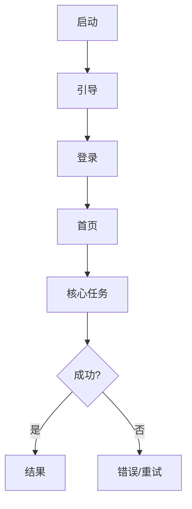

# 功能清单（知识库）

> 版本: v0.1
> 日期: YYYY-MM-DD
> 来源: <App 版本/设备/商店链接>
> 状态: draft

## 1. 功能主表

| 功能 ID | 模块 | 功能名 | 用户目标 | 入口 | 前置条件 | 主路径 | 分支/异常 | 结果 | 权限 | 数据 | 业务规则 | 优先级 | 证据 |
| --- | --- | --- | --- | --- | --- | --- | --- | --- | --- | --- | --- | --- | --- |
| F-001 | 账号 | 手机号登录 | 进入产品 | SCR-001 | 已安装 | 输入手机号 → 验证码 → 登录 | 验证码错误/超时/频繁 | 进入首页 | 通知（可选） | 手机号、token | 60s 重发 | P0 | evidence/login.png |

## 2. 页面清单

| 页面 ID | 页面名 | 入口 | 关键组件 | 状态 | 跳转 | 证据 |
| --- | --- | --- | --- | --- | --- | --- |
| SCR-001 | 登录 | 启动 | 输入框、验证码、CTA | 加载/错误/限流 | SCR-002 | evidence/login.png |

## 3. 状态覆盖

| 页面 ID | 加载 | 空 | 错误 | 离线 | 无权限 | 说明 |
| --- | --- | --- | --- | --- | --- | --- |
| SCR-002 |  |  |  |  |  |  |

## 4. 关键流程

## 5. 业务规则

| 规则 ID | 模块 | 规则 | 观察/推断 | 证据 |
| --- | --- | --- | --- | --- |
| BR-001 | 账号 | 验证码 60s 重发 | 观察 | evidence/login.mp4 |

## 6. 未知项

| ID | 未知项 | 影响 | 下一步 |
| --- | --- | --- | --- |
| U-001 | 付费墙是否首版保留 | 影响范围 | 问产品 |

## 7. 覆盖自检

- [ ] 所有入口映射到页面/功能 ID
- [ ] 每个 P0 有主路径 + 异常 + 空/错/加载
- [ ] 关键流程有 Mermaid
- [ ] 权限/数据/规则已记录
- [ ] 术语统一
- [ ] 未知项显式列出
